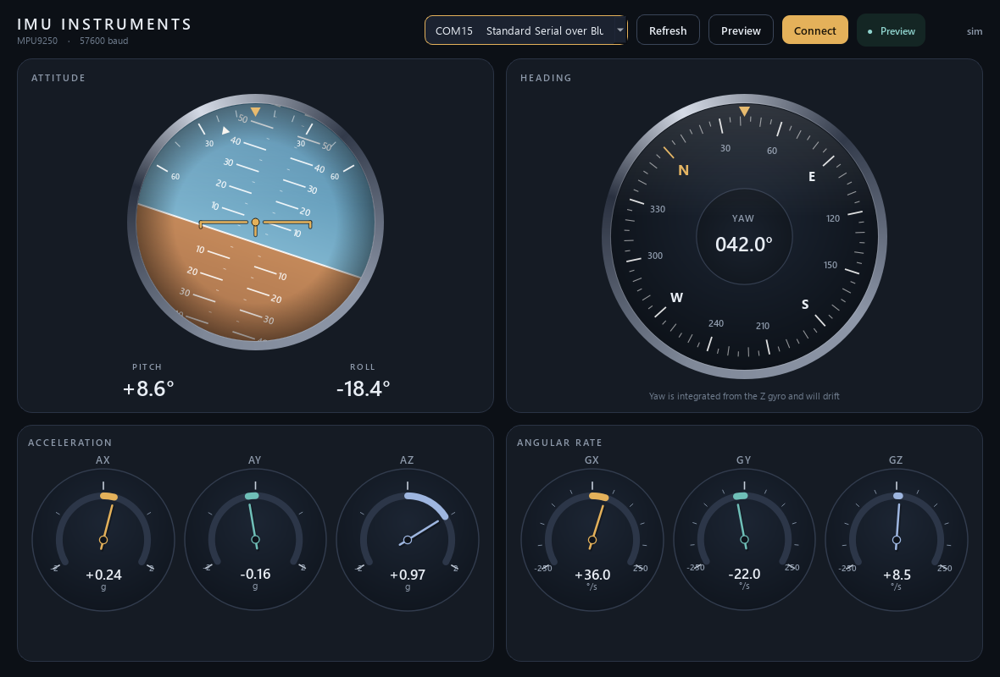
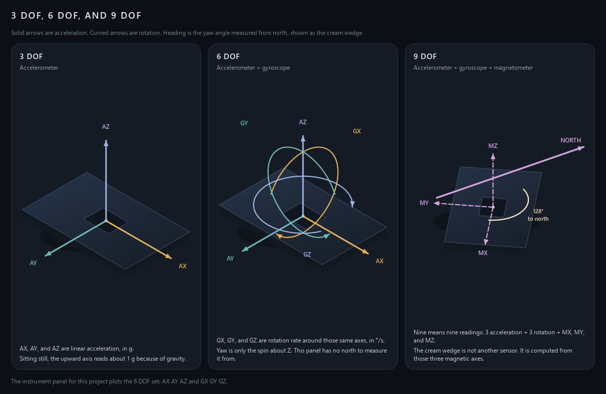

# IMU instrument panel

Arduino sketch and desktop gauges for an MPU9250 on I2C. The board sends pitch, roll, yaw, acceleration, and rotation rate as a fixed 40-byte packet. The instrument panel reads that packet at **57600 baud** and draws it.

This firmware uses six readings: three acceleration axes and three gyro axes. Yaw is integrated from the Z gyro, so the heading drifts. A magnetometer is not in the packet.

## Instrument panel



The horizon shows pitch and roll. The compass shows yaw. **AX AY AZ** are acceleration in g. **GX GY GZ** are rotation rate in degrees per second. With the board still and flat, Z acceleration sits near **+1 g** and the gyro gauges sit near **0**.

## Degrees of freedom



`dof_axes.py` is a separate window that explains the axis count:

| Name | Readings |
|---|---|
| 3 DOF | AX, AY, AZ — linear acceleration |
| 6 DOF | those, plus GX, GY, GZ — rotation rate |
| 9 DOF | those six, plus MX, MY, MZ — magnetic field |

The cream arc on the 9 DOF board is heading: the angle from the sensor’s MX axis to magnetic north. It is calculated from the three magnetic readings. It is not an extra sensor. This project’s packet is the 6 DOF set.

## Run the panel

Close the Arduino Serial Monitor first so the port is free.

```powershell
pip install -r requirements.txt
python imu_dashboard.py
```

Choose the board’s COM port and click **Connect**. Leave the sensor still during gyro calibration. The status stays on “Waiting for packets” while the sketch prints text, then switches to **Live** when binary packets start. **Preview** moves the gauges without a board.

To build a Windows app that does not need Python:

```powershell
python -m pip install pyinstaller
python -m PyInstaller --noconfirm --windowed --name "IMU Instruments" imu_dashboard.py
```

Run `dist/IMU Instruments/IMU Instruments.exe` and keep the files in that folder together. The executable under `build/` will not start on its own.

The axis guide:

```powershell
python dof_axes.py
```

## Firmware

Open `working_imu_i2c.ino` in the Arduino IDE and upload it. The MPU9250 address is `0x68`. Serial is **57600**, 8 data bits, no parity, 1 stop bit.

On startup the sketch prints calibration text, then one 40-byte packet about 50 times a second. The panel ignores the text and locks onto the packets.

| Bytes | Contents |
|---|---|
| 0–1 | Sync `0xAA 0x55` |
| 2 | Payload length `36` |
| 3–38 | Nine little-endian floats: pitch, roll, yaw (degrees), accX/Y/Z (g), gyrX/Y/Z (degrees/second) |
| 39 | XOR of bytes 2 through 38 |

```python
import struct

body = packet[2:39]  # length byte + 9 floats
checksum = 0
for byte in body:
    checksum ^= byte
if checksum == packet[39]:
    length, pitch, roll, yaw, ax, ay, az, gx, gy, gz = struct.unpack("<B9f", body)
```
